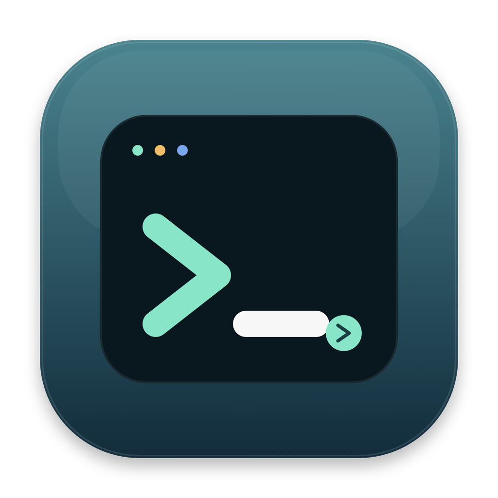

# SSH Deck

[](https://www.apple.com/macos/)
[](LICENSE)

SSH Deck is a native macOS dashboard for the hosts you already manage in OpenSSH. It reads your SSH config, checks host availability, and turns a remote machine into a compact operations view without storing passwords or sending telemetry.



## Highlights

- Discovers concrete `Host` entries from `~/.ssh/config`, including `Include` files
- Resolves the effective hostname, user, port, identity file, jump host, and local forwards with `ssh -G`
- Shows CPU, memory, swap, disk, load, uptime, and SSH round-trip time
- Shows NVIDIA GPU utilization, memory, temperature, and power
- Shows the top remote processes by CPU usage
- Detects Slurm with `sinfo` and summarizes idle, fully allocated, and partially used nodes
- Filters Slurm nodes and shows free CPUs, memory, GPU type, and partition
- Opens a host in Terminal or copies its SSH command
- Supports manual refresh and 15-second to 5-minute auto-refresh intervals
- Keeps the last successful metrics when a host goes offline

## Requirements

- macOS 14 or newer
- OpenSSH available at `/usr/bin/ssh`
- Public-key authentication for hosts that should be monitored automatically
- Linux remotes for the complete metric set (`/proc`, `df`, and optional `nvidia-smi`)
- Slurm `sinfo` available on a remote host for the cluster section

SSH Deck uses `BatchMode=yes` for background probes. It does not prompt for passwords and does not store them. Add your public key to each host's `authorized_keys` if you want automatic metrics.

## Install

Download the latest release zip, unzip it, and move `SSH Deck.app` to `/Applications`.

The release is ad-hoc signed and is not notarized. If macOS blocks the first launch, open it from Finder with the context menu and choose **Open**. On macOS versions that quarantine the download, you can also run:

```bash
xattr -dr com.apple.quarantine "/Applications/SSH Deck.app"
```

The first time you use **Open Terminal**, macOS may ask for permission for SSH Deck to control Terminal.

## Build

```bash
swift test
./scripts/build-app.sh
open "dist/SSH Deck.app"
```

`build-app.sh` builds a universal binary for Apple Silicon and Intel Macs by default. Set `UNIVERSAL=0` to build only the current architecture:

```bash
UNIVERSAL=0 ./scripts/build-app.sh
```

The release artifact is written to:

```text
artifacts/SSHDeck-macos-universal.zip
```

## Configuration

SSH Deck is read-only with respect to SSH configuration. It uses your existing aliases, for example:

```sshconfig
Host workstation-x830
  HostName 203.0.113.10
  Port 6051
  User example
  IdentityFile ~/.ssh/id_ed25519
```

Aliases can contain letters, numbers, hyphens, and dots. Use `Include` if you split configuration across multiple files.

## Security And Privacy

- Reads `~/.ssh/config` and runs the local OpenSSH client
- Does not store, display, or transmit passwords
- Does not upload host data, metrics, or analytics
- Runs only read-only remote shell commands for metrics
- Disables local port forwarding for background probes
- Respects OpenSSH host-key verification and authentication settings

## Limitations

- Full metrics currently target Linux `/proc`
- Non-Linux hosts can still show SSH availability and connection configuration
- GPU metrics depend on `nvidia-smi`
- Slurm metrics depend on `sinfo`

## License

MIT
